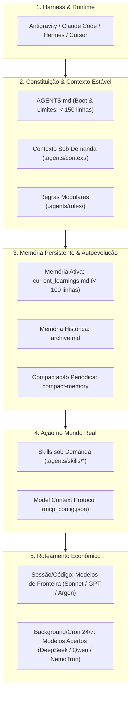

# 🚀 Agent Boilerplate — Arquitetura Padrão para Agentes Autônomos de IA

[](https://github.com/moura07/epic-tesla.git)
[](#-arquitetura-do-ecossistema-5-n%C3%ADveis)
[](#-as-3-meta-skills-inclusas)
[](LICENSE)

Template base de nível corporativo (*production-ready*) para governança e engenharia de contexto de **Agentes de IA Autônomos**. Projetado para eliminar a amnésia entre sessões, prevenir a degradação de atenção (*context rot* / *lost-in-the-middle*) e desacoplar regras operacionais da interface de execução.

Compatível com os principais harnesses e plataformas de agentes do mercado: **Google Antigravity**, **Claude Code**, **Hermes**, **Cursor**, **OpenCodeInterpreter**, terminais e scripts headless via MCP.

---

## 🎯 Por que este Boilerplate Existe? (O Que 95% Não Entende)

A maioria dos desenvolvedores e equipes falha ao tentar escalar o uso de agentes porque:
1. **Trata a IA como um Chatbot Reativo:** envia prompts quilométricos a cada interação e assume todo o custo cognitivo de pensar o próximo passo.
2. **Sofre com a Amnésia da IA:** correções feitas em uma sessão se perdem ao fechar a janela, exigindo reensinar as regras todos os dias.
3. **Estoura a Janela de Contexto:** enche arquivos mestres de regras com mais de 500 linhas, fazendo com que o modelo alucine ou ignore instruções vitais.
4. **Falta de Ferramental Padronizado:** não conecta o agente a procedimentos operacionais reutilizáveis (SOPs) nem a protocolos universais de ferramentas (`MCP`).

Este repositório fornece uma **base limpa, portável e padronizada em Markdown** que transforma qualquer LLM em um colaborador orientado a objetivos (**teleológico**), com memória persistente em 2 camadas e carregamento progressivo de procedimentos.

---

## 🏗️ Arquitetura do Ecossistema (5 Níveis)



---

## 📂 Estrutura de Diretórios Detalhada

```text
.
├── AGENTS.md                                  # Manual mestre / Constituição do Agente (< 150 linhas)
├── README.md                                  # Documentação executiva e guia de onboarding
└── .agents/                                   # Diretório central de governança do agente
    ├── mcp_config.json                        # Conectores com ferramentas externas via MCP
    ├── context/                               # Bases de conhecimento de apoio (lidas sob demanda)
    │   ├── business_context.md                # Regras de negócio, ICP/Personas, produtos e KPIs
    │   └── architecture_and_stack.md          # Stack técnica, árvore de arquivos e comandos canônicos
    ├── rules/                                 # Regras inegociáveis e padrões de conformidade
    │   ├── security_and_guardrails.md         # Prevenção de ações destrutivas, proteção de credenciais e anti-injection
    │   └── git_and_quality_standards.md       # DoD, limites de contexto e padrão de commits
    ├── memory/                                # Sistema de Persistência em 2 Camadas
    │   ├── current_learnings.md               # Caderno ativo de lições aprendidas (lido a cada boot)
    │   └── archive.md                         # Log consolidado de lições promovidas para regras
    └── skills/                                # Procedimentos Operacionais (SOPs) modulares
        ├── bootstrap-project/                 # Skill de Onboarding e Auto-padronização inicial
        │   └── SKILL.md
        ├── create-skill/                      # Fábrica de Skills: encapsula tarefas em novas rotinas
        │   ├── SKILL.md
        │   └── resources/
        │       └── skill_template.md
        └── compact-memory/                    # Higienizador de memória: poda sem perda de contexto
            └── SKILL.md
```

---

## ⚡ Como Começar um Novo Projeto (Passo a Passo)

### 1. Clonar ou Baixar o Repositório

```bash
# Clone o boilerplate para seu novo projeto
git clone https://github.com/moura07/epic-tesla.git meu-novo-projeto
cd meu-novo-projeto

# (Opcional) Redefina a origem do Git para o repositório do seu novo projeto
rm -rf .git
git init
```

### 2. Abrir no seu Harness / IDE de IA Favorita

Abra a pasta do projeto no **Antigravity**, **Claude Code**, **Cursor** ou no terminal com sua ferramenta CLI de agentes.

### 3. Disparar o Bootstrap (Modo Zero Config)

Escolha uma das abordagens no chat do seu agente:

#### Opção A — Se você já tem um briefing ou código existente:
> *"Ative a skill `bootstrap-project` para configurar este repositório com o seguinte contexto: [cole o briefing, escopo ou peça para inspecionar os arquivos da pasta]."*

#### Opção B — Se você quer construir o projeto do zero via entrevista:
> *"Ative a skill `bootstrap-project` no modo de entrevista para estruturarmos o projeto passo a passo."*

O agente fará as perguntas essenciais (uma por vez) e preencherá automaticamente:
- A seção de identidade e papel no [`AGENTS.md`](./AGENTS.md).
- O público, personas e métricas em [`.agents/context/business_context.md`](./.agents/context/business_context.md).
- A stack técnica e comandos em [`.agents/context/architecture_and_stack.md`](./.agents/context/architecture_and_stack.md).
- As restrições de segurança específicas em [`.agents/rules/security_and_guardrails.md`](./.agents/rules/security_and_guardrails.md).

---

## 🛠️ As 3 Meta-Skills Inclusas

| Meta-Skill | Gatilho / Quando Utilizar | Como Funciona |
| :--- | :--- | :--- |
| **`bootstrap-project`** | Início de novos projetos ou ao detectar `[PENDENTE DE CONTEXTO]`. | Transforma contexto desestruturado em arquitetura padronizada sem estourar limites de linhas. |
| **`create-skill`** | Após finalizar uma rotina com excelência (ex.: geração de propostas, auditoria de PRs). | Converte o fluxo em uma nova pasta dentro de `.agents/skills/<nome>/` com frontmatter YAML e DoD. |
| **`compact-memory`** | Quando `current_learnings.md` atinge ~80 a 100 linhas. | Promove aprendizados definitivos para `.agents/rules/` e arquiva o log em `archive.md`, mantendo a memória ativa abaixo de 40 linhas. |

---

## 🧠 Como Funciona o Ciclo de Autoevolução

```text
       [Operador corrige a IA no chat]
                     │
                     ▼
  [IA grava a lição em .agents/memory/current_learnings.md]
                     │
                     ▼
  [A cada novo boot/sessão, a IA relê current_learnings.md]
                     │
                     ▼
  [Atingiu ~80 linhas? Executa a skill compact-memory]
         ┌───────────┴───────────┐
         ▼                       ▼
[Promove para .agents/rules/]   [Arquiva em archive.md]
```

Dessa forma, o agente constrói um **fosso competitivo (*moat*) de contexto acumulado**: após 3 a 6 meses de uso, a operação roda com centenas de ajustes finos memorizados sem degradar a velocidade ou clareza do modelo.

---

## 🔌 Conectando Ferramentas Externas via MCP

O arquivo [`.agents/mcp_config.json`](./.agents/mcp_config.json) vem pré-estruturado para permitir conexões locais (Stdio) ou remotas (Streamable HTTP):

```json
{
  "mcpServers": {
    "meu-banco-sqlite": {
      "command": "npx",
      "args": ["-y", "@modelcontextprotocol/server-sqlite", "./database.db"],
      "env": { "DB_READONLY": "true" }
    },
    "meu-servidor-remoto": {
      "url": "https://mcp.minhaempresa.com/mcp"
    }
  }
}
```

Basta descomentar ou apontar para os conectores do seu ecossistema (Gmail, Notion, Slack, GitHub, Postgres, etc.).

---

## 💰 Estratégia de Roteamento de Modelos (Economia de Tokens)

Para evitar contas proibitivas de API, utilize a regra da segregação de tarefas:

* **Agentes de Sessão (Interativos / Arquitetura / Desenvolvimento):**
  * Use modelos de fronteira com alta capacidade de raciocínio (`Claude 3.5 Sonnet`, `Gemini 1.5 Pro / Argon`, `GPT-4o`).
* **Agentes Persistentes 24/7 (Background / Crons / Triagens Contínuas):**
  * Conecte harnesses contínuos a modelos abertos de baixo custo (`DeepSeek-V3`, `Qwen 2.5`, `GLM-4`) ou modelos locais com custo zero de token via inferência local (`NemoTron` da NVIDIA / `Ollama`).

---

## 🤝 Boas Práticas e Contribuições

1. **Mantenha o `AGENTS.md` enxuto:** Nunca ultrapasse 200 linhas (meta: $\le 150$ linhas). Se uma instrução for detalhada demais, transforme-a em uma **Skill**.
2. **Respeite o DoD (*Definition of Done*):** Teste antes de validar qualquer entrega.
3. **Commits Semânticos:** Utilize sempre `feat:`, `fix:`, `docs:` e `chore:`.

---

## 📄 Licença

Este projeto é disponibilizado sob a licença [MIT](LICENSE) — sinta-se livre para utilizar comercialmente, customizar e distribuir em seus projetos internos e consultorias.
