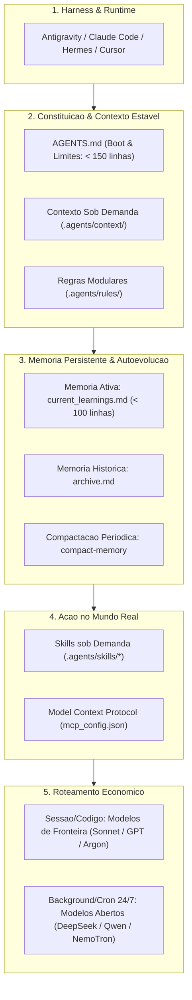

# Agent Boilerplate — Arquitetura Padrão para Agentes Autônomos de IA

[](https://github.com/moura07/epic-tesla.git)
[](#arquitetura-do-ecossistema-em-5-niveis)
[](#as-3-meta-skills-inclusas)
[](#colaboracao-e-evolucao-continua)

Estrutura base corporativa para governança e engenharia de contexto de **Agentes de IA Autônomos**. Projetada para eliminar a amnésia entre sessões, prevenir a sobrecarga da janela de contexto (*context rot* e *lost-in-the-middle*) e desacoplar o manual de conduta do agente da interface de execução.

Compatível com os principais ecossistemas e plataformas do mercado: **Google Antigravity**, **Claude Code**, **Hermes**, **Cursor**, terminais interativos e pipelines headless integrados via MCP.

---

## Fundamentos e Proposta de Valor

A maioria das implementações com modelos de linguagem falha ao tentar escalar tarefas do mundo real por quatro motivos principais:

1. **Tratamento Reativo (Chatbot vs. Agente):** Dependência de prompts pontuais e dispersos, nos quais o operador humano precisa validar e planejar cada passo, assumindo toda a carga cognitiva.
2. **Amnésia Intersessão:** LLMs operam em ambientes efêmeros. Correções realizadas ao longo do dia são descartadas ao fechar a janela, exigindo reensinar diretrizes a cada novo chat.
3. **Sobrecarga de Atenção:** Manuais com centenas de linhas na raiz do projeto saturam a janela de contexto com ruído informacional, degradando o raciocínio lógico e induzindo alucinações.
4. **Acoplamento à Ferramenta:** Regras de negócio aprisionadas dentro de configurações de uma plataforma específica, dificultando a portabilidade entre modelos e ambientes de desenvolvimento.

Este repositório soluciona essas deficiências ao transformar a IA em um **agente teleológico (orientado a objetivos)** através de:
- **Separação entre Chassi e Motor:** Arquitetura desacoplada baseada em Markdown, permitindo alternar livremente entre harnesses e modelos de inferência.
- **Memória em Duas Camadas:** Leitura mandatória de aprendizados ativos no boot e compactação periódica com histórico arquivado.
- **Divulgação Progressiva (*Progressive Disclosure*):** Procedimentos operacionais extensos (*Skills*) carregados sob demanda via metadados, mantendo a janela de contexto limpa e rápida.

---

## Arquitetura do Ecossistema em 5 Níveis



---

## Estrutura de Diretórios

```text
.
├── COMECE_AQUI.md                             # Guia de partida (autodestruído após o bootstrap)
├── ESTRUTURADOR_DE_AGENTE.md                  # Arquiteto de concepção para chats externos (autodestruído após o bootstrap)
├── AGENTS.md                                  # Constituição mestra do Agente (< 150 linhas)
├── README.md                                  # Documentação arquitetural e operacional
└── .agents/                                   # Governança centralizada do Agente
    ├── mcp_config.json                        # Conectores com serviços externos via MCP
    ├── context/                               # Bases de conhecimento de apoio (consultadas sob demanda)
    │   ├── business_context.md                # Regras de negócio, ICP/Personas, glossário e KPIs
    │   └── architecture_and_stack.md          # Stack técnica, árvore de arquivos e comandos canônicos
    ├── rules/                                 # Regras inegociáveis e padrões de conformidade
    │   ├── security_and_guardrails.md         # Prevenção de ações destrutivas, dados sensíveis e guardrails
    │   └── git_and_quality_standards.md       # Definition of Done (DoD), limites e padrão de commits
    ├── memory/                                # Sistema de Persistência em Duas Camadas
    │   ├── current_learnings.md               # Caderno ativo de lições aprendidas (lido no boot)
    │   └── archive.md                         # Log consolidado de lições promovidas para regras
    └── skills/                                # Procedimentos Operacionais Padronizados (SOPs)
        ├── bootstrap-project/                 # Motor de onboarding Fast-Track (autodestruído após o bootstrap)
        │   └── SKILL.md
        ├── create-skill/                      # Fábrica permanente de Skills: encapsula fluxos validados
        │   ├── SKILL.md
        │   └── resources/
        │       └── skill_template.md
        └── compact-memory/                    # Higienizador permanente de memória: poda sem perda de contexto
            └── SKILL.md
```

---

## Como Inicializar um Novo Projeto (2 Modos de Partida)

### 1. Clonar o Repositório

```bash
git clone https://github.com/moura07/epic-tesla.git meu-novo-projeto
cd meu-novo-projeto

# Inicialize um historico limpo para o seu projeto
rm -rf .git
git init
```

### 2. Escolher o Modo de Onboarding

#### 🔥 Modo A (Recomendado — Fast-Track via `ESTRUTURADOR_DE_AGENTE.md`):
1. Anexe o arquivo [`ESTRUTURADOR_DE_AGENTE.md`](./ESTRUTURADOR_DE_AGENTE.md) em qualquer chat tradicional (**Gemini Web, ChatGPT, Claude**).
2. Lapide a ideia com o assistente (ele conectará sua ideia à arquitetura `epic-tesla`, sugerirá novas Skills e estabelecerá automaticamente o padrão ideal de segurança na Etapa 4).
3. Copie o **Bloco Único Fast-Track** gerado ao final e cole no seu agente dentro da IDE (**Antigravity, Claude Code, Cursor**).
4. O agente da IDE executará a gravação em **lote paralelo em 1 único turno (~8 segundos)**, sem refazer perguntas!

#### ⚡ Modo B (Direto na IDE):
Abra a pasta diretamente no **Antigravity, Claude Code ou Cursor** e digite:

> **"Iniciar"** *(ou "Vamos configurar o projeto [Nome do Projeto]")*

### 3. Padronização e Autolimpeza Automática
Ao concluir o bootstrap (seja via Modo A ou Modo B), o agente grava todos os arquivos de governança em paralelo, cria as primeiras Skills em `.agents/skills/` e **remove automaticamente o kit de instalação temporário** (`COMECE_AQUI.md`, `ESTRUTURADOR_DE_AGENTE.md` e `.agents/skills/bootstrap-project/`), deixando o repositório 100% limpo para produção.

---

## As 3 Meta-Skills Inclusas

| Meta-Skill | Ciclo de Vida | Finalidade e Mecanismo de Ação |
| :--- | :--- | :--- |
| **`bootstrap-project`** | Temporária (Autodestruída após o setup) | Materializa a arquitetura inicial em **Modo Fast-Track (1 turno)** ou entrevista guiada e limpa o kit de instalação ao concluir. |
| **`create-skill`** | Permanente | Converte fluxos consolidados em pacotes reutilizáveis em `.agents/skills/<nome>/` com frontmatter YAML e DoD. |
| **`compact-memory`** | Permanente | Transfere aprendizados estáveis de `current_learnings.md` para as regras permanentes e move o histórico para `archive.md`. |

---

## Ciclo de Autoevolução e Acúmulo de Contexto

```text
       [Operador corrige a IA no chat]
                     │
                     ▼
  [IA registra a licao em .agents/memory/current_learnings.md]
                     │
                     ▼
  [A cada nova sessao, a IA relê current_learnings.md]
                     │
                     ▼
  [Ao atingir ~80 linhas, aciona a skill compact-memory]
         ┌───────────┴───────────┐
         ▼                       ▼
[Promove para .agents/rules/]   [Arquiva em archive.md]
```

Esse ciclo contínuo estabelece um **ativo cumulativo proprietário**: ao longo das semanas de uso, o agente refina suas decisões e alinhamento com a equipe sem sofrer lentidão ou dispersão no raciocínio.

---

## Integração com Ferramentas Externas (MCP)

O arquivo [`.agents/mcp_config.json`](./.agents/mcp_config.json) segue a especificação do Model Context Protocol:

```json
{
  "mcpServers": {
    "meu-banco-sqlite": {
      "command": "npx",
      "args": ["-y", "@modelcontextprotocol/server-sqlite", "./database.db"],
      "env": { "DB_READONLY": "true" }
    },
    "meu-servidor-remoto": {
      "url": "https://mcp.minhaempresa.com/mcp"
    }
  }
}
```

Permite conectar ferramentas locais (`Stdio`) ou serviços remotos (`Streamable HTTP`) para leitura de bancos, envio de e-mails, integração com repositórios e chamadas de APIs externas.

---

## Roteamento de Modelos e Otimização de Custo

Para manter a viabilidade econômica em projetos de alta demanda:

* **Sessão Interativa e Arquitetura:** Modelos de raciocínio avançado (`Claude 3.5 Sonnet`, `Gemini Pro / Argon`, `GPT-4o`) para estruturação, análise de código complexo e criação de novas Skills.
* **Tarefas Contínuas de Background (24/7):** Modelos abertos de alta eficiência (`DeepSeek-V3`, `Qwen 2.5`, `GLM-4`) ou execução local com custo zero de tokens (`NemoTron`, `Ollama`) para crons, triagens e rotinas automatizadas.

---

## Diretrizes de Uso e Boas Práticas

1. **Concisão no `AGENTS.md`:** Manter o arquivo sempre abaixo de 200 linhas (recomendado: até 150 linhas). Regras extensas pertencem a `.agents/rules/` e fluxos detalhados a `.agents/skills/`.
2. **Critério de Validação Obrigatório (DoD):** Toda tarefa deve ser inspecionada na prática antes de ser considerada concluída.
3. **Padrão de Versionamento:** Commits atômicos no formato Conventional Commits (`feat:`, `fix:`, `docs:`, `chore:`).

---

## Colaboração e Evolução Contínua

Este repositório foi concebido como um padrão vivo para a comunidade de engenharia de agentes de IA. Melhorias em regras de governança, novas meta-skills e aprimoramentos nos protocolos de contexto são amplamente bem-vindos.

Sinta-se livre para abrir *issues*, sugerir melhorias estruturais via *pull requests* ou adaptar este modelo para as particularidades do seu time ou empresa.
